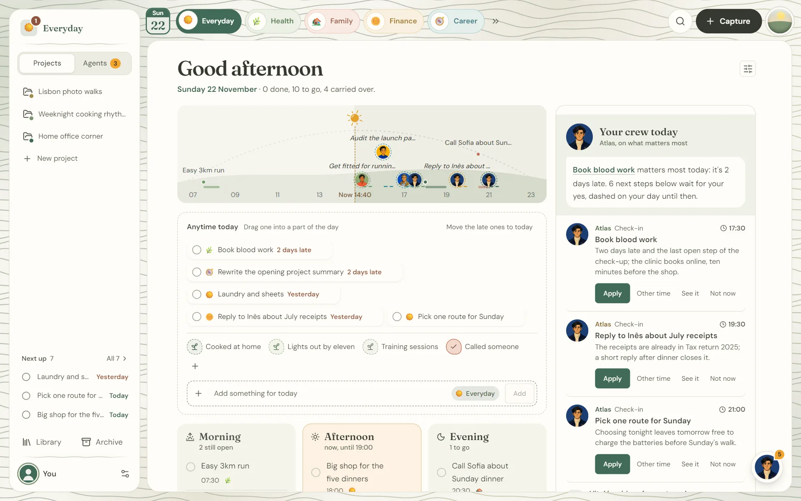
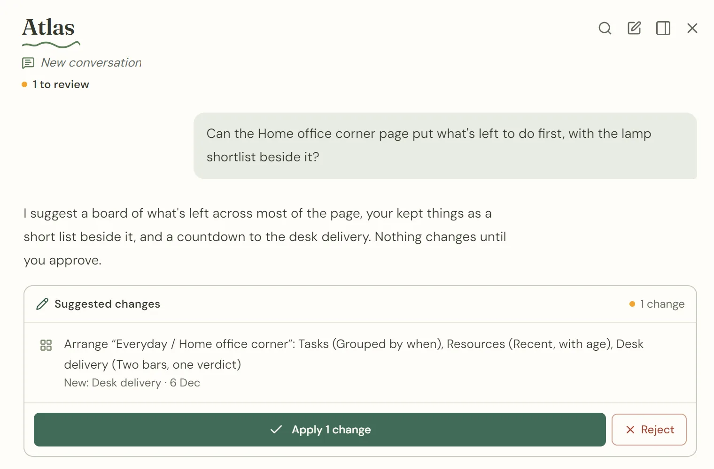
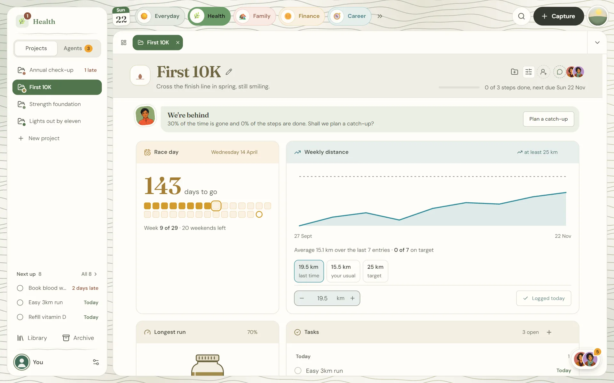
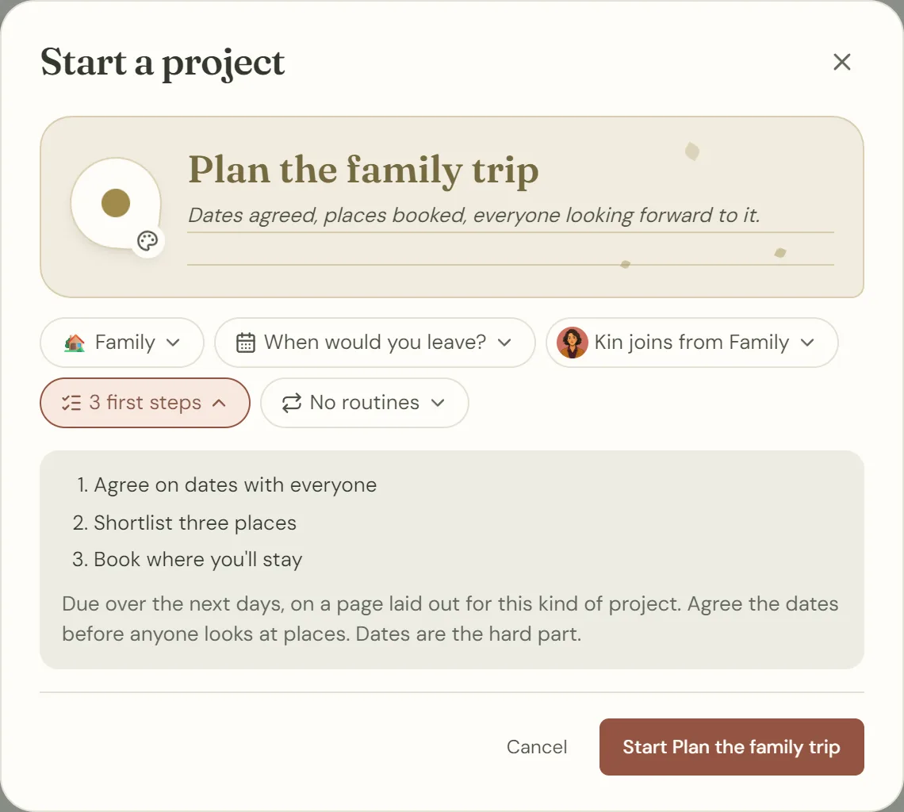
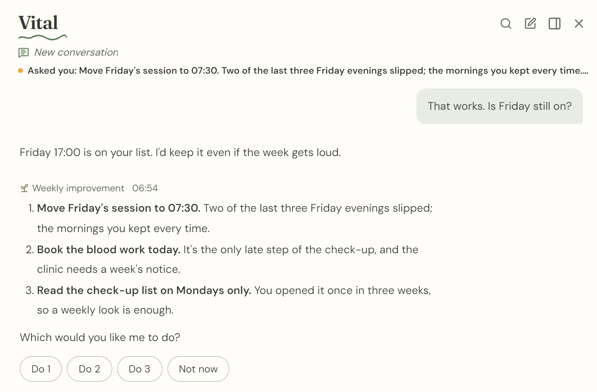
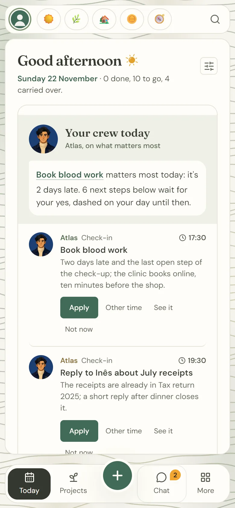
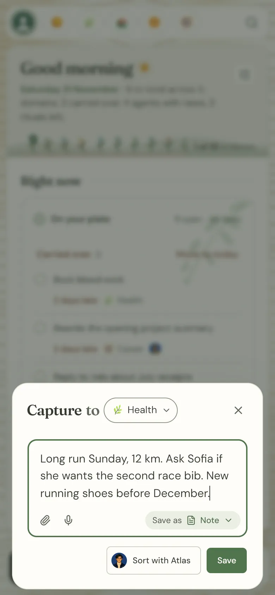

<p align="center">
  
</p>

<h1 align="center">Atlaswork</h1>

<p align="center">
  A personal workspace where AI agents look after the parts of your life.<br>
  <a href="https://atlaswork.app">Website</a> ·
  <a href="https://app.atlaswork.app">Open the app</a> (closed beta) ·
  <a href="DEVELOPMENT.md">Development</a> ·
  <a href="https://carlosoliveira.me/">Author</a>
</p>



## Features

- **Today.** Your whole day on one page: tasks, what carried over, and each agent's next step.
- **An agent per domain.** Atlas, plus Hearth (home), Vital (health), Kin (family), Ledger (money) and Compass (career).
- **They suggest, you decide.** Agents propose changes; you apply them or undo them.
- **Projects from a sentence.** Describe the goal and the agent drafts the project, its stages and its tasks.
- **Routines.** Check-ins and weekly reviews that run on the server while you're away, with push notifications.
- **On your phone.** Installable web app with quick capture and share-to-Atlaswork.
- **Your own AI model.** OpenRouter, OpenAI, Anthropic or any OpenAI-compatible API, on the free plan too.
- **Windows app.** Agents search and tidy files on your computers, asked from any device.
- **Google Calendar.** Optional: agents read your schedule and add events you hand them.

| Agents propose, you approve | A project page |
|---|---|
|  |  |
| **Start a project in one line** | **Weekly improvement routine** |
|  |  |

<p align="center">
  
  
</p>

## Quick start

Requires Node 22 and pnpm.

```sh
pnpm install
pnpm dev        # http://127.0.0.1:5191
```

Without a backend the app runs in your browser with agents offline. To run your own backend (Supabase), agents and the desktop app, see [DEVELOPMENT.md](DEVELOPMENT.md).

## Built with

React, TypeScript and Vite · Supabase (Postgres with row-level security, Edge Functions on Deno) · Tauri 2 for the Windows app.

## Contributing

Issues and pull requests are welcome. Read [CONTRIBUTING.md](CONTRIBUTING.md) first; contributors sign a [CLA](CLA.md). Report security problems privately, as [SECURITY.md](SECURITY.md) explains.

## License

[AGPL-3.0](LICENSE) © [Carlos Oliveira](https://carlosoliveira.me/)
